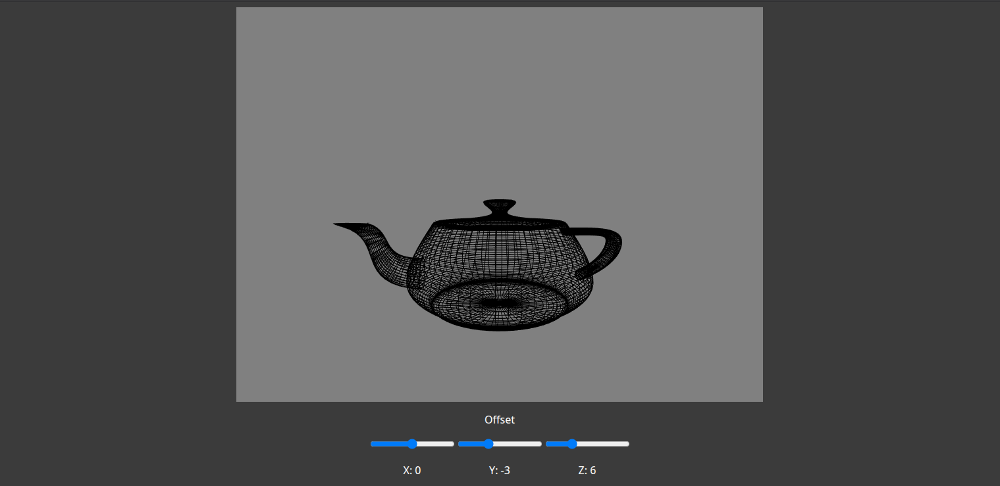

# html canvas 3d renderer

Display your obj model:
```shell
python3 obj_to_js.py path/to/file.obj
```



Resources:
- [Perspective projection](https://en.wikipedia.org/wiki/3D_projection#Perspective_projection)
- [Rotation matrix](https://en.wikipedia.org/wiki/Rotation_matrix#Basic_3D_rotations)
- [Cartesian coordinate system](https://en.wikipedia.org/wiki/Cartesian_coordinate_system)
- [OBJ format](https://en.wikipedia.org/wiki/Wavefront_.obj_file)
- [One Formula That Demystifies 3D Graphics (Tsoding)](https://www.youtube.com/watch?v=qjWkNZ0SXfo)
- [The Utah Teapot](https://graphics.cs.utah.edu/teapot/)
